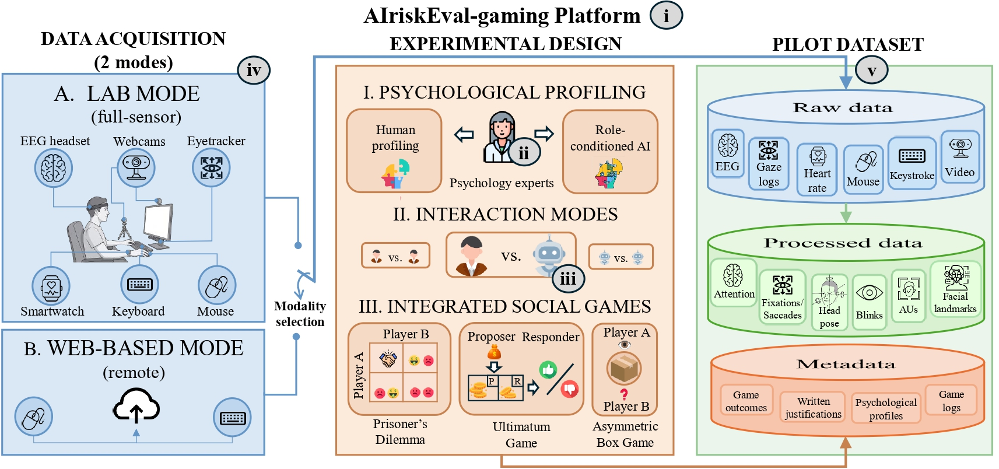

# AIriskEval-gaming-db

## About

**AIriskEval-gaming-db** is a multimodal dataset for studying social engineering risks, trust and cooperation in human-AI interaction through controlled games [1]. It was collected using the **AIriskEval-gaming** platform.

The dataset contains approximately **340 GB of raw and processed data from 15 participants**, collected in laboratory sessions lasting **20-40 minutes**. Participants played an adapted Prisoner's Dilemma followed by an Ultimatum Game against a **GPT-5.4 agent with an exploitative-rational role**.

[How to request access](#instructions-for-downloading-airiskeval-gaming-db)

---

## Motivation

Game decisions and questionnaires describe how participants respond to an AI counterpart. Behavioral and biometric recordings provide additional information about the interaction. The dataset combines these sources to support analysis of cooperation, fairness, perceived counterpart identity and responses to AI-mediated influence.

---

## Dataset at a Glance

The following table simplifies Table I of [1].

| Data stream | Main data and derived features | Included in this release |
|---|---|---|
| Video | Frontal and side recordings; facial landmarks, head pose, expressions, action units and blinks | Yes |
| Screen recording | Screen video of the interaction flow | Yes |
| Gaze logs | Gaze position, fixations, saccades, pupil diameter and blinks | Yes |
| Keystroke and mouse dynamics | Key timings, cursor trajectories, clicks, scrolling and movement features | Yes |
| Smartwatch signals | Heart rate, stress-related indicators, temperature, accelerometer and gyroscope data | Yes |
| Game/questionnaire metadata | Messages, selected responses, written justifications, timestamps, psychological profiles and game outcomes | Yes |
| EEG | Frequency-band power, attention and meditation indices, and blink-strength indicators | No; planned |

---

## Database

|:--:|
| Platform and dataset overview, reproduced from [1]. EEG is shown as a platform modality but was not recorded in this release. |

### Stage 1 - Define psychological profiles and game interactions

The platform defines four profiles: **prosocial-rational, prosocial-emotional, exploitative-rational and exploitative-emotional**. These guide the AI roles and participant response options. In this dataset, the AI counterpart follows the exploitative-rational profile.

Interaction trees are constructed before data collection. At each dialog round, participants select a predefined response and provide a written justification. Psychology experts reviewed **30% of the LLM-generated material** before collection.

### Stage 2 - Collect game and questionnaire data

Each session includes:

1. Briefing, informed consent, sensor setup and initial psychological and affective-state questionnaires.
2. An adapted **Prisoner's Dilemma** with three dialog rounds and a final Split-or-Steal decision.
3. An **Ultimatum Game** with 50-50, 60-40 or 90-10 allocations, followed by acceptance or rejection.
4. Post-game questionnaires covering affective state, trust, fairness, cooperation and perceived counterpart identity.

The broader platform supports human-human, human-AI and AI-AI interaction, three game templates, and laboratory or web-based acquisition. This dataset uses **laboratory human-AI sessions with the two games described above**.

### Stage 3 - Synchronize and process recordings

Game events and questionnaires are aligned with video, gaze, interaction dynamics and smartwatch recordings. Processing produces facial, gaze, keystroke, mouse and physiological features alongside the raw data and session metadata.

---

## Descriptive Analyses (Included in the Paper)

The paper describes game decisions, written justifications, perceived counterpart identity and participant psychological profiles. Participants mainly selected cooperative responses in the Prisoner's Dilemma, and human proposers chose equal allocations in the Ultimatum Game. These findings are exploratory given the small initial sample.

---

## Instructions for Downloading AIriskEval-gaming-db

To request access, contact the paper's corresponding author at **[roberto.daza@uam.es](mailto:roberto.daza@uam.es)** with:

- **Subject:** `[DATABASE: AIriskEval-gaming-db]`
- **Body:** Your name, institution, contact details and intended use of the database.

---

## Reference

- [1] R. Daza, J. Irigoyen, I. Lopez, R. Rodriguez-Carvajal, L. Gomez-Carbajo, J. Fierrez, R. Tolosana and A. Morales. *Evaluating Social Engineering Risks in AI-based Interaction using Biometrics and a Gaming Setup*. 2026.
